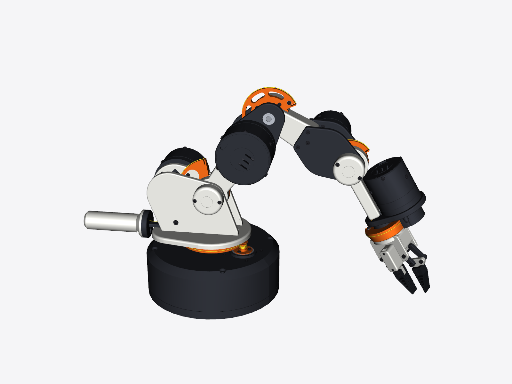

# Capstan Arm 5: design and build guide

A 5-axis, 3D-printed robot arm: base yaw, shoulder, elbow, wrist pitch and wrist roll. A micro servo drives a parallel-jaw gripper with soft TPU Fin Ray fingertips.

Every joint is a **low-KV gimbal motor driving a Dyneema capstan directly**, with no gearbox. A zero-backlash TPU jaw coupling links the motor to the pulley. The result:

- **No backlash.** There is no gear play anywhere in the drive.
- **Backdrivable.** You can push the arm around by hand with the power off.
- **Quiet.** There are no gears to whine.
- **Clean force sensing.** Motor current maps directly to joint torque, which is what force control, admittance control and "follow my hand" modes need.

Each joint has a **moteus-c1** driver on the back of its motor. It reads the motor's built-in encoder and a second encoder on the joint itself through its aux port, so every pitch joint has dual encoders.

> The previous drone-motor + cycloid version is kept in `legacy/arm_v1_cycloid/` for reference.

## What's in here

| Folder | What it is |
|---|---|
| `print/stl/` | Every printed part, already rotated to its print orientation. |
| `print/step/arm_assembly.step` | Full coloured assembly with every printed and purchased part. |
| `print/step/actuator_GL40.step`, `actuator_GL60.step` | One actuator of each size on its own. |
| `cad/out/step/printed_parts/` | Each printed part as its own STEP, for editing in any CAD program (generated by `python cad/build.py`). |
| `docs/BOM.md` / `BOM.csv` | Quantities for every printed and purchased part, plus cable lengths. |
| `bom/capstan_arm_parts.html`, `bom/bom_priced.csv` | Priced shopping list with links. Edit `bom/bom_data.py` and run `python bom/make_bom.py` to change it. |
| `docs/report.md` | Ratios, torque budget per joint, balancer, accuracy. |
| `cad/arm/` + `cad/build.py` | The parametric source. Change a number and rebuild; everything regenerates. |
| `viewer/` | The interactive 3D viewer (open it through a local web server). |
| `docs/images/` | Rendered views. |

## Motors and drivers

| Joint | Motor | Capstan ratio | Rated / peak torque at the joint | Worst gravity load, 0 / 500 g payload |
|---|---|---:|---:|---:|
| J1 base yaw | CubeMars GL40 KV70 | 9.7:1 | 2.2 / 4.5 Nm | – |
| J2 shoulder | CubeMars GL60 KV25 | 10.4:1 | 5.7 / 16.7 Nm | 3.2 / 5.6 Nm (spring removes about half) |
| J3 elbow | CubeMars GL60 KV25 | 8.0:1 | 4.4 / 12.9 Nm | 1.3 / 3.0 Nm |
| J4 wrist pitch | CubeMars GL40 KV70 | 6.5:1 | 1.5 / 3.0 Nm | 0.4 / 1.4 Nm |
| J5 wrist roll | CubeMars GL40 KV70 | 6.0:1 | 1.4 / 2.8 Nm | – |

- **Payload:** every joint holds a 500 g payload continuously at its rated torque, anywhere in its range.
- **Motor specs:** the motor figures come from CubeMars' published specs (GL60: 0.6 Nm rated, 1.75 Nm peak, 230 g; GL40: 0.25 Nm rated, 0.5 Nm peak, 107 g). Joint figures assume 92 % capstan efficiency.
- **Base motor:** a GL60 won't fit in the base next to the J1 bearing boss. Base yaw needs little torque, so it uses a GL40.
- **Moving mass:** about 1.5 kg past the shoulder.

**Before printing, fix the motor hole patterns.** The motor mounting-hole patterns in `MOTORS` (`cad/arm/params.py`) are placeholders. Download CubeMars' 2D drawing for each motor and copy in the rotor and stator bolt circles. Do the same for the moteus-c1 mounting holes (`DRIVER["holes"]`, from mjbots' STEP file), then rebuild.

One more thing to check on arrival: the design assumes the motor's hollow shaft turns with the rotor. The magnet plug for the driver's encoder sits in its rear end. If your motor's bore turns out to be stationary, glue the magnet to the rotor adapter instead and move the driver to the front.

## Actuator (each joint)

Front to back:

1. **Capstan drum** on a hub that runs in a preloaded pair of thin 6705 bearings inside the front cap. The front cap bolts to the fork cheek.
2. **Jaw coupling.** Three dogs on the hub and three on the rotor adapter, with a TPU 95A spider between them. Print the spider about 2 % oversize so it goes in under preload. This takes up misalignment between the motor's bearings and the pulley's without adding backlash.
3. **Gimbal motor.** The rotor adapter bolts to the rotor face. The stator bolts to the rear plate.
4. **moteus-c1 driver** on standoffs behind the rear plate. Its encoder chip faces a magnet in the motor's hollow shaft.
5. **Rear lid** with a cable exit.

Radial M3 button heads hold the rear plate and lid in the can, so the whole motor and driver package slides out from the back.

**Assembly**
1. Press `act_bearing_spacer` and both 6705 bearings into the front cap: one bearing from each side of the inner lip.
2. Slide the hub in from the rear. Fit the retainer ring at the front with 3 × M3×6 button heads; this preloads the bearings.
3. Bolt the rotor adapter to the motor. Bolt the motor to the rear plate. Press the magnet plug into the motor's rear bore with the driver's magnet in it.
4. Mount the driver on its standoffs, chip toward the magnet, with about 1.5 mm gap.
5. Slide the plate into the can and fit the 3 radial screws. Fit the lid the same way.
6. Put the spider on the hub dogs. Bolt the can to the front cap with 4 × M3×10 so the adapter dogs push into the spider.
7. Bolt the front cap to the fork cheek with 4 × M3×10 from inside the fork.

**Capstan**
1. Thread the cable through the pulley's cross-hole and lock it with the grub screw.
2. Wind about 2 turns each way in the helical groove.
3. Lay the cable along the sector rim, through the notches, and under the clamp washers.
4. Pull it tight with pliers before clamping the second end. Dyneema creeps, so re-tension after the first hour of running.

## Electronics

- **Drivers:** 5 × moteus-c1, 10–51 V input, daisy-chained. XT30 carries power and JST PH-3 carries CAN-FD.
- **PC link:** one mjcanfd-usb-1x connects the CAN-FD chain to a PC. mjbots' Python library drives the joints directly.
- **Joint encoders:** 4 × AS5047P breakouts on J1–J4, plugged into each driver's aux port (SPI). Wrist roll runs on its motor encoder; with no backlash, that's accurate at the joint too.
- **Power:** a 24 V supply with a latching emergency stop in the motor power line.
- **Gripper:** a Raspberry Pi Pico runs the servo over USB, from a 5 V buck converter.

## Shoulder balancer

A spring cartridge behind the turret takes about half the shoulder's gravity load.

- **Optional, but recommended.** The GL60 can hold the arm without it.
- **Effect:** peak shoulder torque drops from 3.2 Nm to 1.7 Nm, and average heating drops about 5×.
- **How it works:** a Dyneema cable runs from a pin on the upper arm, around an idler on the turret, and into the cartridge, where a 2:1 pulley compresses a spring. The geometry makes it a "zero-length" spring, so its torque follows the cosine shape of the arm's own gravity torque.
- **Spring:** music wire 2.2 mm, OD 21 mm, free length about 78 mm, rate about 3.2 N/mm, ends closed and ground. Rerun `python cad/analysis_balance.py` with your spring's real numbers if it differs by more than about 10 %.

**Assembly**
1. Press the 3×8 dowel into the middle hole of the ear on the upper arm and slide the printed spool onto it.
2. Bolt the idler, with its 684ZZ bearing, to the inside of the encoder-side turret cheek using the M4×20 bolt and spacer.
3. Bolt the bracket to the turret plate, then screw the tube onto the bracket's bulkhead with the spring and piston inside.
4. Tie the cable round the spool. Run it under the idler, through the top bulkhead hole, round the piston pulley, and back out through the lower hole.
5. With the arm pointing straight up, pull the cable snug and clamp it under the washer on the front of the bulkhead.
6. Test with the motors off and the arm straight out. It should drift slowly rather than drop. If it sags, move the pin to the outer ear hole; if it floats up, move it to the inner hole.

## Accuracy

Run `python cad/analysis_accuracy.py`; the full table is in `docs/report.md`.

**Backlash:** zero when new. If the TPU spider takes a 0.05 mm set, that becomes about 0.05–0.09° at each joint, or about ±0.4 mm (RSS) at full reach. Reprint the spider (it takes minutes) or close the loop on the joint encoders.

**Cable stretch under gravity:** about 0.9 mm at full reach in the worst case, less in typical poses. This assumes an effective 15 kN EA for 1 mm Dyneema braid, which is an estimate.

**Motor-encoder resolution at the joint:** about 0.002–0.004°, or under 0.1 mm at the tool.

**Controlling on the joint encoders (J1–J4):** slack and stretch drop out of the resting position.
- Repeatability is about ±0.3 mm (RSS) at full reach.
- Absolute accuracy depends on calibration: about ±1.4 mm RSS at 0.1° encoder accuracy.

For comparison, the drone-motor + cycloid version was about ±1.6 mm RSS as printed, from backlash alone.

## Printing

Ready-made plates for a **Bambu Lab P1S** (or any 256 mm bed) are in `print/plates/`: 14 one-filament 3MF files, numbered in **assembly order**, so you can build each sub-assembly while the next one prints.

1. **One pathfinder actuator** (about 8 h). Use it to check your printer's bearing fits before printing the rest.
2. The other four actuators.
3. The base and turret.
4. The upper arm and balancer.
5. The forearm.
6. The wrist and gripper.

`print/plates/PLATES.md` has the timeline and what to build at each stage. Regenerate the plates with `python cad/make_plates.py` (then `python cad/export_print_files.py`) after changing anything; edit `STAGES` in that file to change the order.

- **Material:** PETG for most parts. Use TPU 95A for `finray_tpu.stl` and `act_spider_tpu.stl`.
- **Fin Ray tips:** print them lying flat with 2 walls and 0 % infill, so the ribs are the walls themselves.
- **Spiders:** print solid.
- **Settings:** 0.2 mm layers, 4 walls, 30 % gyroid infill. Use 100 % infill for `act_hub` and `act_rotor_adapter_*`.
- **Supports:** none needed, except under the flange of `act_hub`. Print it dogs-down with a little support under the flange. Every other part was checked for overhangs over 45°.
- **Colour scheme:**
  - White: links, turret, palm and joint caps.
  - Graphite: actuators, fork cheeks, yoke and base.
  - Orange: sectors, hubs and roll flange.
  - Black TPU: fingertips and spiders.
- **Bed size:** the largest part is the base (200 mm diameter), so a 220 mm bed is enough.

## Joints, wrist and gripper

**Joints**
1. Press the 608 bearings into the cheeks from the inside.
2. Lock the 8 mm shaft into the child hub with the grub screw.
3. Fit the joint cap so the encoder sits 1.5 mm above the shaft magnet.

**Wrist roll**
1. Press both 608 bearings into the yoke boss from the front, with `roll_spacer` between them.
2. Slide the 8 mm × 30 mm shaft through from the front and fit the e-clip in the rear recess.
3. Put the M8 shim on the shaft, slide on `roll_flange`, and lock it with the grub screw from underneath.
4. Bolt the roll actuator's front cap to the back of the yoke with 4 × M3×10. Wind the cable, then screw on `roll_pulley_guard`.

**Gripper**
1. Screw the servo horn into the recess on `link_drive_upper`.
2. Mesh the two drive links' gears with the jaws closed. Pin the lower drive link and both follower links with M3×35 bolts and nyloc nuts.
3. Press the servo spline into the horn, fit the horn screw through the access hole, and fit `servo_cover`.
4. Fix each Fin Ray tip with 2 × M3×16 and nuts.
5. Center the servo before meshing the gears, then set its travel in software. Pads are 1 mm apart at 0° and 38 mm apart at 50°.

## Things to know

- **Range of motion:** the ranges in `cad/arm/params.py` are collision-checked limits. Some postures can still touch the base, so add Cartesian keep-outs in software.
- **Current limits:** the GL60's peak is about 3× its rated torque, and at peak the shoulder could put about 300 N on its cable. Set current limits in the moteus config (around the rated current for continuous running) so a stall can't overload the sectors.
- **Encoder boards:** the generic AS5047P board is 30×18 mm with M2 holes 24 mm apart. If yours differs, edit `ENC` in `cad/arm/params.py`.
- **Rebuild and checks:** `pip install cadquery scipy trimesh`, then `python cad/build.py`, which takes about 3 minutes. Then run:
  - `python cad/check_interf.py home`
  - `python cad/check_poses.py`
  - `python cad/check_balancer.py`

## Miniature display model

`print/mini/` has a 3 in (76 mm) tall desk model (about 1:4.2) of the whole arm in the real colours: four multi-colour pieces on one P1S plate (`capstan_arm_mini.3mf`, AMS slots 1 white, 2 graphite, 3 orange, 4 black) that glue together on 1.75 mm filament dowels. See `print/mini/MINI.md`. Regenerate it with `python cad/make_mini.py`, or e.g. `python make_mini.py 1/2` for a bigger one.

## Inverse kinematics

`ik/capstan_ik.py` (numpy only) turns a tool target (x, y, z, pitch, roll, grip) into all five joint angles, moteus motor positions and the gripper servo angle, with limit and keep-out checks, a Jacobian and straight-line moves. See `ik/IK.md`; `python ik/test_ik.py` checks it against the CAD.

## Simulator and RL training

`sim/` is a MuJoCo model of the arm built from the CAD, with real motor torque-speed curves, capstan ratios and reflected inertia, the moteus PD loop with gravity feedforward, and the servo gripper's delay and grip force. It runs thousands of copies in parallel on an NVIDIA GPU (MJX).

- **The beanbag** is floppy: a 3×3 grid of hinged beans, checked against MuJoCo's full soft-body model.
- **Pickup:** the arm picks it off the table with a press-and-pinch grasp.
- **Throws** start from 2,000 real pickups.
- **Tasks:** reach, lift, place, throw and pick-and-throw.
- **Training:** Brax and Stable-Baselines3 algorithms, launched as a parallel population and compared on a leaderboard.
- **Throw study:** the longest throw is 2.78 m for a floppy 2 in 25 g bag. The same throw from different pickups scatters ±20 cm, which is why the throw policy watches how the bag is held.

See `sim/SIM.md`.
