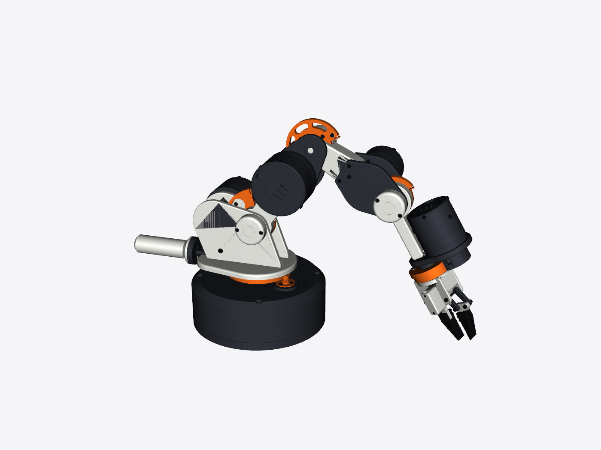

# Capstan Arm 5, miniature (76 mm / 3.0 in tall, 1:4.2)

A display model of the whole arm in its display pose, in the real colours, sized for a desk. The outside matches the full-size arm; the inside is solid.

## Print

Open `capstan_arm_mini.3mf` in Bambu Studio. It's one plate with four multi-colour pieces, and each piece's colours are already assigned to filaments 1–4. Load the AMS to match:

| AMS slot | Filament | ≈ g |
|---:|---|---:|
| 1 | PETG or PLA, white (#EBEBE6) | 6 |
| 2 | PETG or PLA, graphite (#30333A) | 29 |
| 3 | PETG or PLA, orange (#F56B1A) | 2 |
| 4 | PETG or PLA, black (#121214) | 0 |

- **Settings:** 0.12 mm layers (0.08 mm if you want the screw heads crisp), 3 walls, 15 % infill. At this size a 0.2 mm nozzle keeps much more detail (sector spokes, screw heads, gripper links); the standard 0.4 mm nozzle works but softens the small features.
- **Supports and brims are already set** on each piece in the project: tree (auto) supports in graphite for B–D (the actuators stick out sideways), plus a brim on C and D because they stand on their small cut faces.
- **Purge:** enable *flush into objects' infill* to cut purge waste; most colour changes happen inside solid infill.
- PLA works as well as PETG here and is easier at this scale.
- If the colours don't come through (an older Bambu Studio), run `python cad/make_mini.py` to get per-colour STLs in `stl/` (left out of the download to keep it small): select all of one piece's files, import them together, answer **Yes** to "load as a single object with multiple parts", then set each part's filament.

| Piece | What | Size on the bed (mm) | Prints on |
|---|---|---|---|
| A | Base | 48 × 48 × 22 | its flat bottom |
| B | Turret, shoulder and balancer | 33 × 60 × 30 | the turret drum |
| C | Elbow | 29 × 19 × 34 | the upper-arm cut face |
| D | Wrist and gripper | 41 × 29 × 71 | the forearm cut face |

## Assemble

The pieces glue together; where there's room, a short length of 1.75 mm filament in a 2.0 mm hole works as a dowel to line them up.

- **A–B** (yaw axis): 1 × 10 mm dowel.
- **B–C** (upper-arm cut): no dowel. The link is too thin for one at this size, but the two faces are the same shape, so line up the edges and glue flat.
- **C–D** (forearm cut): no dowel. The link is too thin for one at this size, but the two faces are the same shape, so line up the edges and glue flat.

Glue with CA, or with a drop of 2-part epoxy if you want time to line things up. Dry-fit first. The cut faces only meet one way. The base–turret joint can also be left unglued so the turret swivels.

Regenerate with `python cad/make_mini.py` (or e.g. `python make_mini.py 1/3` for a smaller one). It rebuilds from the same parametric source, so any change to the arm shows up in the mini.
