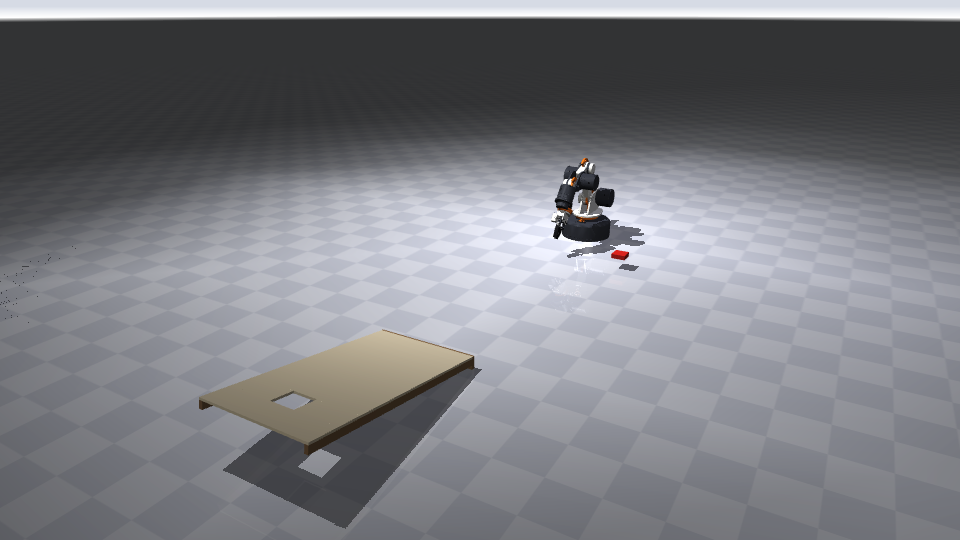

# Capstan Arm 5 simulator

The simulator is a physics model of the arm built from the CAD, plus a set of training tasks. It runs thousands of copies at once on an NVIDIA GPU using MuJoCo MJX, and lets several RL algorithms train side by side.

It includes a floppy beanbag and a real table pickup. Every throw starts from however the bag actually ended up in the gripper.



## Setup (Linux or WSL2, NVIDIA GPU)

```bash
pip install "jax[cuda12]" mujoco mujoco-mjx brax stable-baselines3 sb3-contrib gymnasium imageio[ffmpeg] trimesh
python sim/smoke_test.py                 # compiles and steps every task
python sim/pick_eval.py 100              # scripted table pickups over random bag poses
python sim/scripted_throw.py 2.37        # replays a known throw through the GPU env and scores it
python sim/make_video.py                 # renders out/pick_and_throw.mp4
```

- **Rebuilding the model:** `sim/assets/` already contains the generated model and the grasp library. After any change to the arm, rebuild them with `python sim/build_model.py` (this step needs cadquery) and `python sim/make_grasps.py`.
- **Optional speed-up:** `pip install warp-lang mujoco-warp`, then create envs with `impl="warp"` to use MuJoCo Warp. It can be much faster with many contacts on NVIDIA GPUs.

## What's modelled

| | |
|---|---|
| **Links** | Masses and inertias come from the CAD, 2.79 kg in total with 1.5 kg moving past the shoulder. Collision shapes are simple boxes. |
| **Motors** | CubeMars datasheet values: GL60 at 5.5 Ω, 21.5 rpm/V, 4 A peak; GL40 at 4.5 Ω, 63.5 rpm/V, 3.3 A peak. They run at 24 V through each motor's torque-speed curve. |
| **Drive** | Each capstan has its ratio, 92 % efficiency, and the rotor's inertia multiplied by the ratio squared. |
| **moteus** | A position + velocity PD loop at 500 Hz, with gravity feedforward from the model, the same as moteus's `feedforward_torque`. |
| **Balancer** | The fitted spring torque curve, applied at J2. |
| **Gripper** | The real parallelogram linkage. The MG90S servo reaches its 0.21 N·m stall within a few degrees, moves at 600°/s and has 10–25 ms of delay. The Fin Ray pads are slightly soft. |
| **Beanbag** | The floppy model below. |
| **Pinch** | The pinch latch below. |
| **Board** | Regulation proportions at any scale, with side rails, a back panel and an equal-area square hole. The top's collision slab is 25 mm thick so a fast bag can't tunnel through it. |

**Domain randomisation, per episode:** PD gains, motor torque, servo delay, bag mass ±25 %, bag friction, and sensor and camera noise.

### The floppy beanbag

The bag is a 3 × 3 grid of weighted spheres, the "beans", joined by hinges. The hinges have a little spring and damping and, most importantly, dry friction, which is why a beanbag stays where it's pushed instead of springing back. MJX can't run MuJoCo's soft bodies, so this is the GPU-friendly way to get the same behaviour.

`sim/bag_calibrate.py` checks it two ways:

| Test | Bead-grid bag | MuJoCo full soft body (CPU) |
|---|---|---|
| Held by one edge, far side droops | 57° | – |
| Held by the middle, sides droop | 13° | – |
| Tossed at 4 m/s, 35° down: bounce | 14 mm | 16.5 mm |
| Tossed at 4 m/s, 35° down: slide | 102 mm | 105 mm |

The droop angles are my estimate for a bean-filled 2 in bag. Photograph yours held by an edge, measure the angle, and adjust `Bag.bend_*` in `sim/scene.py` until it matches.

### The pinch latch

A real pinch pushes the beans aside and clamps folded cloth between the pads. Nine rigid beads can't fold like cloth, so a pinch is modelled as a latch (`sim/pinch.py`):

- **Grab:** while the gripper is closing, as soon as both pads press on the bag, the nearest bead is welded to the gripper with a slightly springy constraint. The rest of the bag still hangs and flops.
- **Release:** it lets go when the jaws have actually opened 3° past their tightest squeeze, including the servo's delay and speed.
- **Slip:** it also lets go when holding the bag would take more force than the pinch can supply: twice the friction times the servo's pad force through the linkage, about 9 N. That's plenty for a 25 g bag, but only about 2 g for a regulation 450 g bag.

**Release delay depends on how hard you squeeze.** If the servo has been commanded fully shut past the bag, it first has to travel back through that gap before the jaws open. A command just past contact releases faster. The policy controls the gripper continuously, so it can learn to ease off before a throw.

## Picking the bag off the table

A flat 2 in bag is wider than the jaws open (38 mm), and the bottom finger can't get under it. The scripted pickup (`sim/skills.py`, `pick()`) does what a person would:

1. Point the gripper down with the jaws across the bag.
2. Press the pads onto it.
3. Squeeze, so the pads pinch it.
4. Lift.

It's driven exactly the way the real arm will be: IK → joint setpoints → moteus PD with gravity feedforward. The same routine can drive the hardware.

`python sim/pick_eval.py` gives 100 % success over random bag positions and orientations with 5 mm of camera error. That's optimistic, because the latch can't fail once both pads touch the bag. Measure the real success rate on the arm and add it as a pinch-failure probability.

**Other grasps I tried and dropped:**

- **Edge pinch** (one pad beside the bag, one on top): the 16 mm beads just slid out of the pinch.
- **Tilted edge pinch:** this needs the bag farther from the base than the arm can reach with the gripper tilted.

`sim/make_grasps.py` runs 2,000 pickups with random bag poses, camera error and press depth, then carries each bag to a ready pose. That's the grasp library. Where the bag sits in the gripper varies by about 4 mm along the fingers, 5 mm across and 2.5 mm along the jaws.

## How far it can throw

Measured with `sim/throw_study.py`: the floppy bag, starting from a real table pickup, through the full controller with the latch.

| Bag | Max throw (first touch) | Release |
|---|---|---|
| 2 in, 25 g | **2.78 m** | 4.8 m/s at 34° |
| 3 in, 60 g | 3.34 m | 4.5 m/s at 35° |

The earlier rigid-brick estimate was 3.57 m for the 2 in bag. A floppy bag hangs and lags in the swing, so the real figure is lower.

**Grip scatter is the precision problem.** The same open-loop throw from 200 different pickups lands with a spread of ±20 cm along the throw and ±5 cm across (1 standard deviation), and 90 % within 35 cm of the mean. None slipped or dropped. That spread comes purely from how the bag happened to be pinched. A fixed throw can't hit a 2 in hole that way; a policy that sees how the bag is held can.

**Release timing:** at the best throw, releasing 5 ms early costs 3 cm and 5 ms late costs 14 cm. The servo's delay is randomised in training, and on the real arm the release should be a scheduled trigger rather than a plain 50 Hz servo pulse.

**Default throw task:** a 1/3-scale board (8 × 16 in, 2 in hole), the board's front edge 1.0–2.4 m from the base and ±30° to either side. Every episode starts from a random grasp in the library.

## Tasks

| Task | Goal | Rate | Episode |
|---|---|---|---|
| `reach` | Tool point to a random reachable target, at its approach pitch | 100 Hz | 3 s |
| `lift` | Pinch the floppy bag off the table and lift it 15 cm | 100 Hz | 4 s |
| `place` | Pick the bag up and set it down on a target spot | 100 Hz | 5 s |
| `throw` | Cornhole, starting from a real pickup (the grasp library) | 250 Hz | 2.5 s |
| `pick_throw` | The whole thing: pick the bag off the table, then throw it | 250 Hz | 5 s |

**Actions** are 6 numbers in [-1, 1]. The first five set the speed of each joint's position target, up to twice the motor's no-load speed; targets may lead the arm, and the motor model limits the real speed. The sixth sets the gripper, from closed to open.

**Observations** cover joint positions and speeds, the gripper, the tool position and orientation, the last action, and task-specific values:

- **Throw:** where the bag's centre and edges sit in the gripper (with noise, as a wrist camera would see them), whether the bag is held, the bag's velocity, and the hole's position.
- **Lift:** the bag's pose and how its edges lie.

**Throw reward,** paid three times so the policy gets signal long before the bag stops:

- **at release,** for where the bag is heading (its ballistic landing point versus the hole);
- **at first contact,** for where it hit;
- **at the end,** for points: 3 for passing down through the hole, 1 for resting on the board, including hanging on the hole's edge.

**Suggested order:** train `throw` from the grasp library first, then `lift`. Use `pick_throw` to fine-tune the whole sequence, or run a lift policy and a throw policy one after the other.

## Training many algorithms at once

```bash
python sim/train.py --task throw --algo brax_ppo --tag first_try         # one run
python sim/train.py --population sim/populations/throw.json              # 7 runs, 3 at a time on one GPU
python sim/leaderboard.py runs/throw                                     # compare them
python sim/play.py runs/throw/ppo_base --distance 2.0                    # evaluate + video
```

- **Algorithms:** `brax_ppo` and `brax_sac` keep the whole loop on the GPU. `sb3_ppo`, `sb3_sac`, `sb3_td3` and `sb3_tqc` run Stable-Baselines3 on the same GPU-simulated environments.
- **Population files:** each run sets its own algorithm, seed, hyperparameters and environment settings, such as a nearer board for a curriculum, or `"bag": {"model": "rigid"}` for fast early training.

## Files

| | |
|---|---|
| `build_model.py` | CAD → `assets/arm.xml` (with visuals), `arm_col.xml` (training), `arm_meta.json` |
| `scene.py` | Floor, lights, the floppy bag and the board, all parametric |
| `control.py` | Motor and driver model, shared by the GPU envs (JAX) and the CPU tools (numpy) |
| `pinch.py` | The pinch latch: grab, release, slip |
| `skills.py` | Scripted pickup and throw on CPU MuJoCo through the IK and moteus-style control |
| `envs.py` | The five tasks (Brax `Env` interface) |
| `bag_calibrate.py` | Drape and landing checks for the bag model |
| `pick_eval.py`, `make_grasps.py` | Pickup success rate; the grasp library (`assets/grasps.npz`) |
| `throw_study.py` | Longest throw, grip scatter, release timing |
| `scripted_throw.py`, `make_video.py` | Checks the GPU env against the CPU controller; renders videos |
| `sb3_vec.py`, `train.py`, `populations/`, `leaderboard.py`, `play.py` | Training and evaluation |
| `jax_compat.py` | A shim so Brax 0.14 runs on JAX 0.11+ |

## Checks done

- **GPU vs CPU physics:** MJX and CPU MuJoCo give identical joint trajectories for the same torques.
- **Throw env vs CPU controller:** for the same throw from the same pickup, the GPU throw environment and the CPU controller agree within 1° throughout the swing and within 2 ms at release.
- **Smoke tests:** every task compiles and steps with no NaNs.

## Known gaps

- **Pinch success:** the latch makes pickups and holds more reliable than a real cloth pinch will be. Measure real pickup and slip rates, then calibrate.
- **Bag shape:** the bag is 9 beads. It drapes and slumps realistically but won't fold into a narrow hole the way cloth can. A bag centred over the hole may sit across it rather than drop in.
- **Capstan stretch:** the cable is modelled as rigid; the real one stretches by about 0.9 mm at the tool.
- **Speed:** the floppy bag and gripper contacts make each copy about 10× heavier than the rigid-brick version. I haven't measured GPU throughput because this machine has no GPU. Start with `impl="warp"` or a rigid bag if training is slow.
